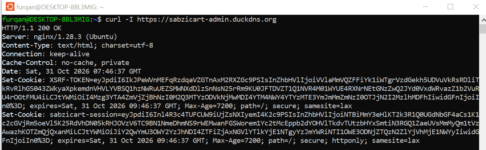
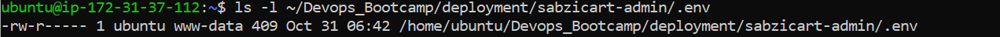
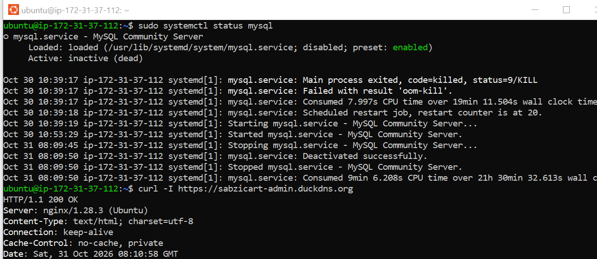
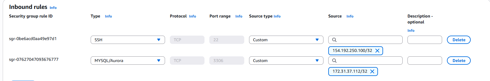
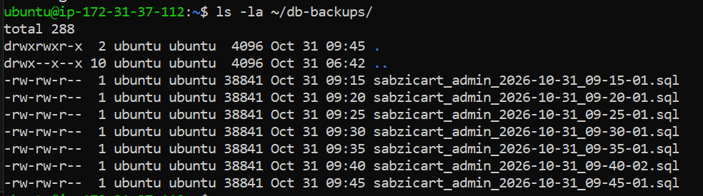
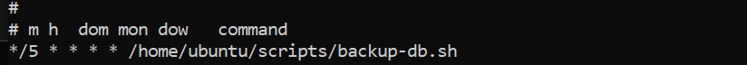
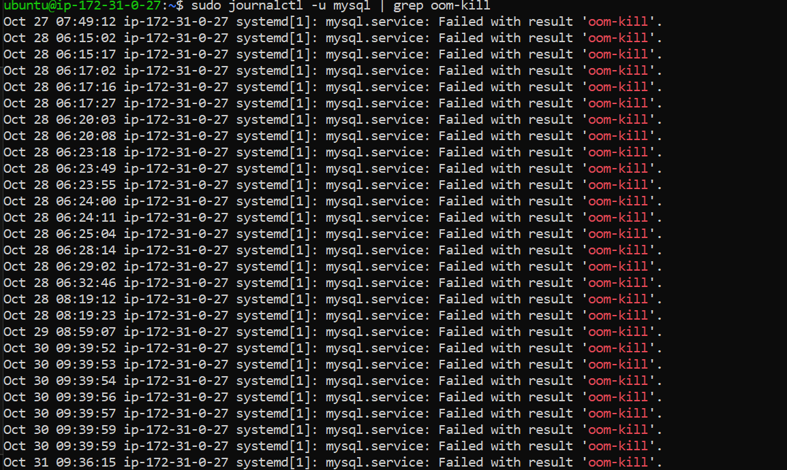
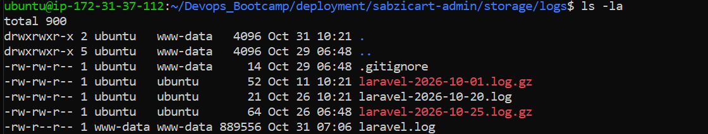
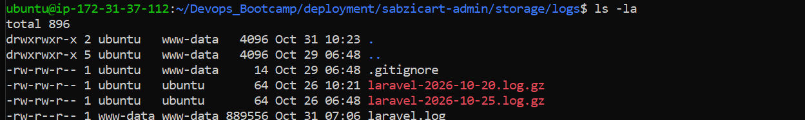
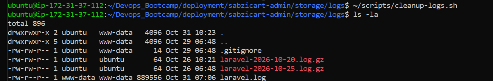

# Deployment Assignment: Laravel App on Two Servers

Live site: https://sabzicart-admin.duckdns.org

## Task 1: Deploy on One Server

Deployed Laravel on `app-vm` (AWS EC2), with nginx as the web server, PHP-FPM running the app, and MySQL on the same server initially.

- nginx serves only `sabzicart-admin.duckdns.org`; the app folder's `public/` directory is the document root. Opening the server's bare IP address directly does not show the app.
- A dedicated MySQL user (`larauser`) was created for the app — not the MySQL root user.
- `APP_ENV=production` and `APP_DEBUG=false` are set, so visitors never see stack traces or debug information.
- `.env` is owned by `ubuntu:www-data` with mode `640` — readable only by the owner and the web server's group, not by other users on the machine, and nginx has an explicit rule blocking all dotfiles from being downloaded through the browser.

**Screenshot: site responding correctly over HTTPS**

**Screenshot: `.env` file permissions**

## Task 2: Move the Database to db-vm

Created a second EC2 instance (`db-vm`) running MySQL only. Moved the database over and switched the app's `.env` to point at it.

- `db-vm`'s security group only allows port 3306 from `app-vm`'s private IP — no other machine on the network can reach it.
- The MySQL user is scoped to only log in from `app-vm`'s private IP (`CREATE USER 'larauser'@'<app-vm-private-ip>'`), separate from the version of the user scoped to `localhost`.
- MySQL on `app-vm` was stopped and disabled (not uninstalled), confirming the app depends entirely on `db-vm` going forward.

**Screenshot: MySQL stopped on app-vm, and the app still working**

**Screenshot: db-vm's security group, showing the restricted source**

## Task 3: Deploy Updates with GitHub Actions

Code lives in a private GitHub repository (`Devops_Bootcamp`). `.env`, `vendor/`, and log files are excluded via `.gitignore`.

A GitHub Actions workflow (`.github/workflows/deploy-laravel.yml`) runs on every push to `main`, and can also be triggered manually from the Actions tab. Each deployment:
- Pulls the latest code (`git pull`)
- Installs dependencies (`composer install --no-dev`)
- Runs any new migrations (`php artisan migrate --force`)
- Rebuilds caches (`config:cache`, `route:cache`, `view:cache`)
- Reloads PHP-FPM

**Screenshot: GitHub Actions tab showing a successful deploy**

*Still to do: a second update that adds a new database column via migration, and a deliberately broken push to demonstrate the workflow failing and then recovering.*

## Task 4: Backup Strategy

A cron job on `db-vm` runs every 5 minutes, dumping the database with `mysqldump` and sending it to `app-vm` over SSH, using a dedicated SSH key created specifically for this purpose rather than the main admin key.

- Backups land in `/home/ubuntu/db-backups/` on `app-vm`, each file named with its date and time, and only readable by the `ubuntu` user.
- A second script keeps only the 7 most recent backup files, deleting older ones automatically on every run.

**Screenshot: backup files on app-vm, timestamped**

**Screenshot: cron schedule on db-vm**

### Unplanned real-world outage

On 2026-10-30, MySQL on `db-vm` was killed by the Linux kernel's out-of-memory killer (confirmed via `journalctl -u mysql`, result `oom-kill`). The app was down with a 500 error for approximately 21 hours before it was noticed and manually restarted.

What this showed:
- The app correctly failed closed (a 500 error) rather than showing stale or corrupted data when the database became unreachable.
- Backups from before the outage were intact and available, so a restore would have lost at most 5 minutes of data if one had been needed.
- Root cause: `db-vm` had no swap space configured, unlike `app-vm`, which had already been fixed after an earlier, similar incident. A 1GB swap file was added to `db-vm` afterward to prevent a repeat.

**Screenshot: journalctl showing the OOM kill**

## Task 5: Logs Cleanup Strategy

Laravel's logging was switched from a single ever-growing file to one log file per day (`LOG_STACK=daily` in `.env`).

A script, scheduled nightly via cron, does three things:
- Compresses `.log` files older than 1 day (today's active log file is left alone)
- Deletes compressed `.log.gz` files older than 14 days
- Writes a warning to its own log if the logs folder exceeds 500MB
- Leaves `.gitignore` and anything else in the folder untouched

Tested with fake old log files: a file backdated 5 days was correctly compressed, a file backdated 20 days (already compressed) was correctly deleted, and running the script a second time changed nothing.

**Screenshot: before the script runs**

**Screenshot: after the first run**

**Screenshot: second run, nothing changes**

On Ubuntu, the web server's and MySQL's own logs in `/var/log` are already rotated automatically by `logrotate`, a built-in system service with its own daily cron schedule and per-service configuration files under `/etc/logrotate.d/` — a separate, pre-existing mechanism from the one built here for Laravel's own `storage/logs/` folder.

## Questions

**1. Why should the app's MySQL user on db-vm only be allowed from app-vm's address?**
The app's MySQL user should be allowed from app-vm because that is where the backups of the database are generated and stored from db-vm.

**2. In the broken update, was the live site affected? Why, or why not? What would you change in the workflow so broken code never reaches app-vm?**
*Not yet tested — a deliberately broken push has not been performed. Once done: if the deploy workflow pulls new code and restarts services before any check confirms the app is actually working, a broken update would reach app-vm and break the live site immediately, since nothing currently validates the code before it's live. The fix is to add an automated test step (or at minimum a health check against the new code) that runs before the deploy applies, so the workflow stops and fails if the app doesn't come up correctly — broken code would then never reach app-vm at all.*

**3. Why is it important to store the backups on app-vm and not on db-vm? What happens to them if app-vm dies?**
It is important to store the backups on app-vm because if something happens to db-vm — since it is a machine anything can happen — all the data is not lost, because the backups of it are present on app-vm. If app-vm dies, only the backups will be lost and the database itself will remain safe on db-vm.

**4. With your backup schedule, what is the most data you could lose?**
Backups run every 5 minutes, so the most data that could be lost is 5 minutes' worth. For example, if a backup runs at 2:00 PM and db-vm fails at 2:04 PM, only the data entered between 2:00 and 2:04 PM would be lost — everything up to 2:00 PM is safely backed up on app-vm. This 5-minute window is the Point-in-Time Recovery (PITR) gap for this setup.

**5. Why should you test restoring a backup, and how often?**
*A backup that has never actually been restored is unproven — the file could be corrupted, incomplete, or missing something important, and the only way to know for certain is to actually try restoring it, not just confirm the file exists. This should be tested periodically (for example, once a month) and again any time the backup script itself changes, so a silent failure is caught before it's actually needed in a real emergency.*

**6. When you type your domain in the browser, how does your laptop find app-vm's IP address? And how does the web server on app-vm know which site to show?**
*Typing the domain triggers a DNS lookup: DuckDNS acts as the DNS provider for this domain, and it answers with app-vm's public IP address, the same way any other domain name resolves to an IP. The browser then connects to that IP and sends the domain name along in the request's `Host` header. Nginx on app-vm reads that `Host` header and matches it against the `server_name` in its site configs, which is how it knows to serve this specific app instead of some other site that might be running on the same server.*
