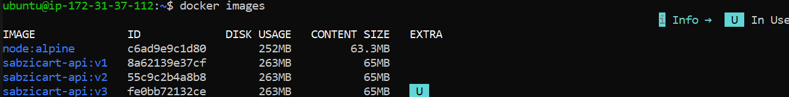
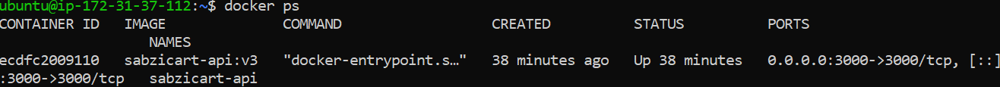

# Assignment 4: Dockerize and Deploy the Node.js App

## Task
1. Dockerize the Node.js application from the previous assignments.
2. Deploy the container to a VM (AWS EC2).
3. Update nginx configuration as required.
4. Route a domain to the app and install an SSL certificate.

## Steps

### 1. Dockerize the app
Wrote a Dockerfile using the `node:alpine` base image. It sets a working directory, copies the package files first and installs dependencies (so dependency installs are cached separately from code changes), copies the rest of the app code, exposes port 3000, and starts the app with `node server.js`.

Dockerfile used:
```dockerfile
FROM node:alpine
WORKDIR /app
COPY package*.json ./
RUN npm ci --omit=dev
COPY . .
EXPOSE 3000
CMD ["node", "server.js"]
```

A `.dockerignore` file excludes `node_modules`, logs, `.env`, and `.git` from being copied into the image, since dependencies are installed fresh inside the container.

### 2. Deploy to the VM
- Installed Docker Engine on the EC2 instance with `sudo apt install docker.io`.
- Pulled the project code onto the server with `git clone` / `git pull`.
- Built the image on the server: `docker build -t sabzicart-api:v1 .`
- Ran the container with port mapping and automatic restart:
  `docker run -d -p 3000:3000 --name sabzicart-api --restart unless-stopped sabzicart-api:v1`
- Stopped and disabled the old systemd service that previously ran the app directly on the host, since the app now runs inside a container instead.

### 3. Nginx configuration and port binding
No changes to nginx's `proxy_pass` were needed. Nginx was already forwarding requests to `127.0.0.1:3000`. The app inside the container listens on `0.0.0.0:3000` (not `127.0.0.1`, which would only accept connections from inside the container itself), and Docker's `-p 3000:3000` flag maps the container's port 3000 to the same port on the host. From nginx's point of view, port 3000 on the host behaves identically whether it is served by the containerized app or the previous host process.

### 4. Domain and SSL
- Registered a free subdomain on DuckDNS pointing at the EC2 instance's public IP.
- Issued an SSL certificate with Certbot: `sudo certbot --nginx -d <domain>`, which also configured the automatic HTTP to HTTPS redirect.

## Screenshots

### Docker images on the VM
`docker images`



### Docker container running on the VM
`docker ps`



## Live result
https://sabzicart-node.duckdns.org
